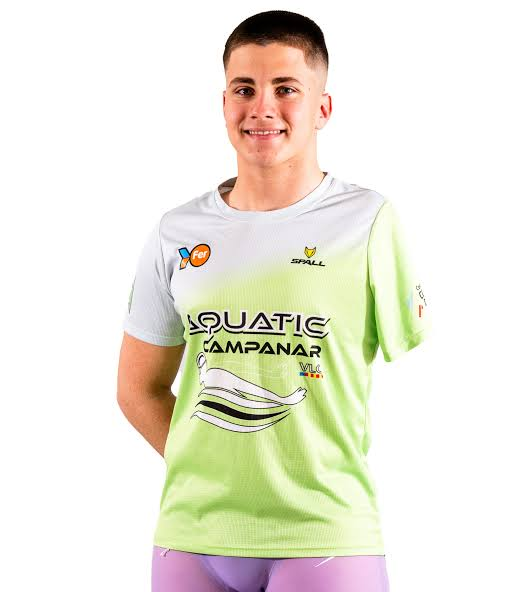

# Repositorio 2º DAW

**Este es un repositorio creado para una práctica de DAW.**

_Mi amigo Carlos_

## Ficheros del repositorio

- .gitignore
- images.jpeg
- index.html
- README.md

[Aules](https://aules.edu.gva.es/fp/my/)

### Ramas

1. main
2. version1

  <head>
    <meta charset="UTF-8" />
    <meta name="viewport" content="width=device-width, initial-scale=1.0" />
    <title>Document</title>
  </head>
  <body>
    <h1>Módulos de DAW</h1>
    <ul>
      <li>Despliegue de Aplicaciones Web</li>
      <li>Introduccion a la nube publica</li>
      <li>Sostenibilidad Aplicada al Sistema Productivo</li>
      <li>Desarrollo web en entorno servidor</li>
      <li>Disenyo de interfaces web</li>
      <li>Desarrollo web en entorno cliente</li>
    </ul>
`
